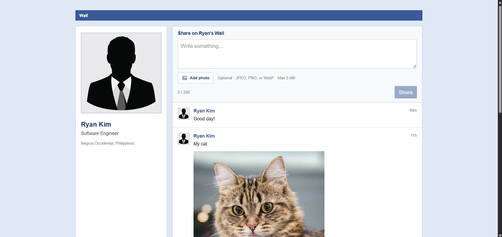
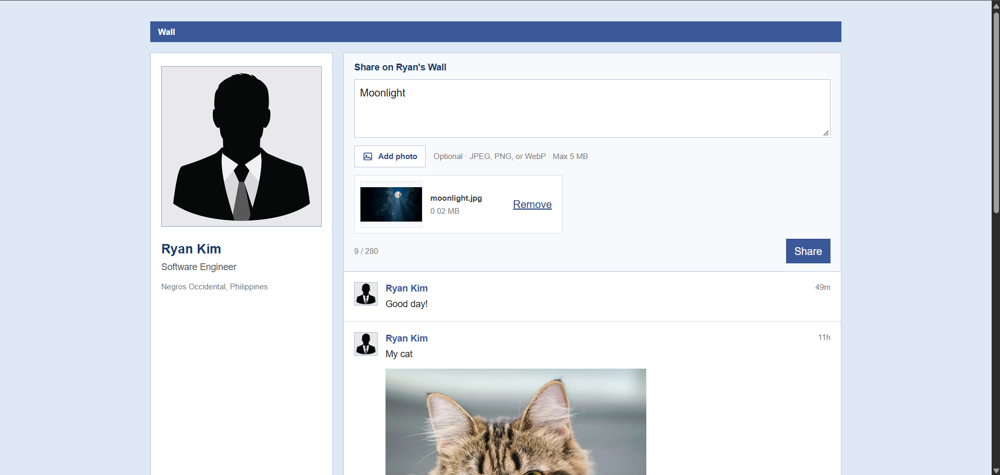

# My Wall

A nostalgic, 2008-style public profile wall built with Next.js, React, TypeScript, Tailwind CSS, and Supabase.

**Live site:** [mywall-mu.vercel.app](https://mywall-mu.vercel.app/)

## Screenshots



The composer also supports optional photo attachments with a preview:



## Features

- Responsive profile and wall layout.
- Publish text posts up to 280 characters.
- Optionally attach a JPEG, PNG, or WebP image up to 5 MB.
- Store posts and photo URLs in Supabase; upload images to Supabase Storage.
- Display the newest 50 posts first and receive new posts through Supabase Realtime.
- Show relative post times, with the full date and time available on hover.

## Tech stack

- [Next.js](https://nextjs.org/) with the App Router
- React and TypeScript
- Tailwind CSS
- Supabase Database, Storage, and Realtime

## Run locally

1. Install dependencies:

   ```bash
   npm install
   ```

2. Create `.env.local` in the project root and add your Supabase project URL and publishable key:

   ```env
   NEXT_PUBLIC_SUPABASE_URL=https://YOUR_PROJECT_ID.supabase.co
   NEXT_PUBLIC_SUPABASE_PUBLISHABLE_KEY=YOUR_SUPABASE_PUBLISHABLE_KEY
   ```

   `NEXT_PUBLIC_SUPABASE_ANON_KEY` is also supported as an alternative key variable. Never put a Supabase service-role key in the browser or a `NEXT_PUBLIC_` variable.

3. Run [`supabase/schema.sql`](./supabase/schema.sql) in the Supabase SQL Editor. It configures public post access and the `wall-photos` Storage bucket policies, including the `photo_url` column.
4. Enable Realtime for the `public.posts` table in your Supabase project.
5. Start the development server:

   ```bash
   npm run dev
   ```

6. Open [http://localhost:3000](http://localhost:3000).

## Scripts

| Command | Description |
| --- | --- |
| `npm run dev` | Start the local development server |
| `npm run build` | Create a production build |
| `npm run start` | Run the production server |
| `npm run lint` | Run ESLint |

## Supabase notes

The wall does not require authentication. Anyone with access can read posts, publish posts, and upload photos. Configure moderation, rate limiting, and stricter access controls before using it for a production community.
